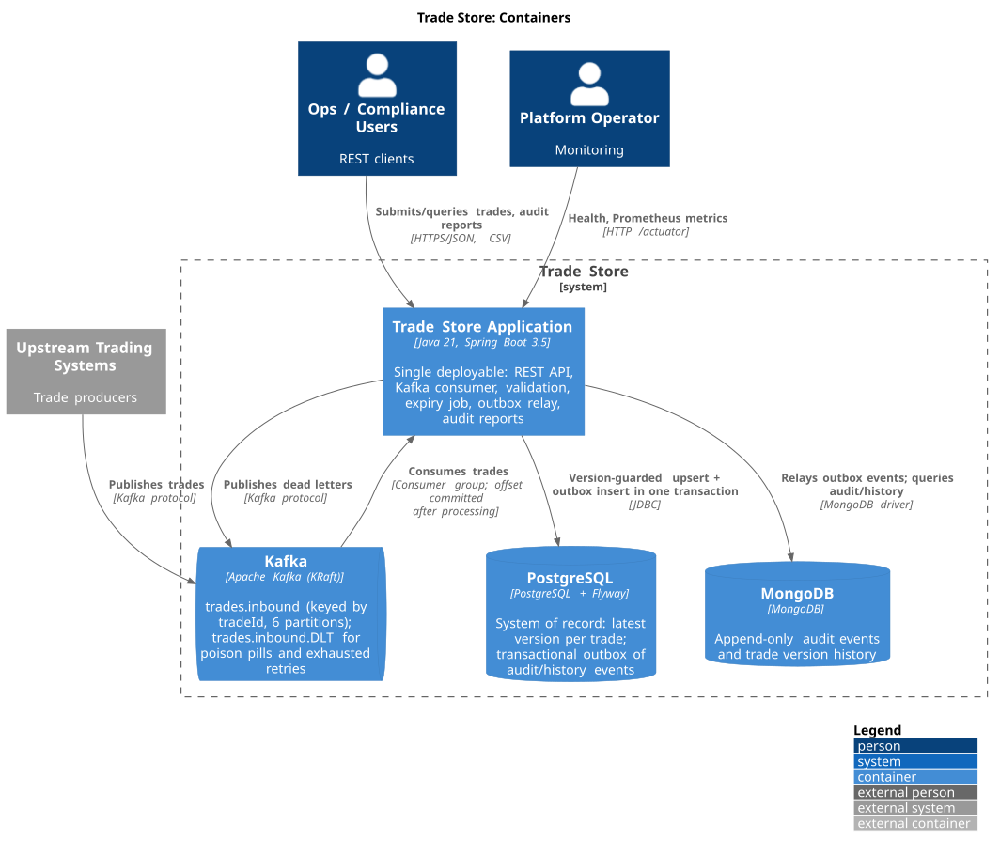
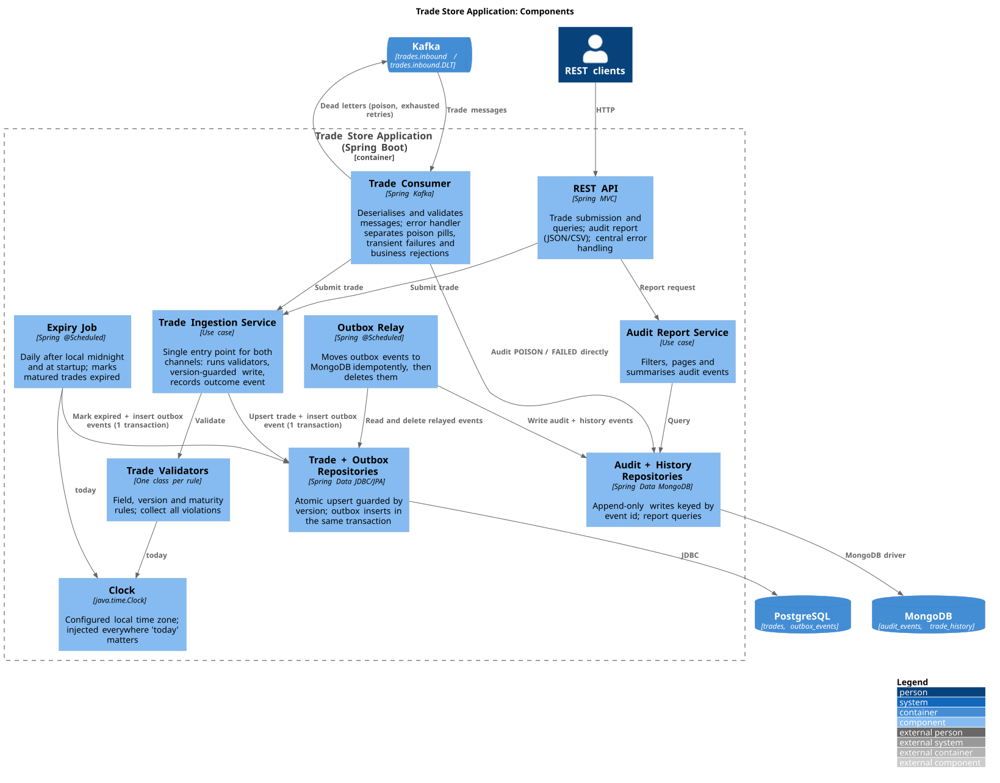
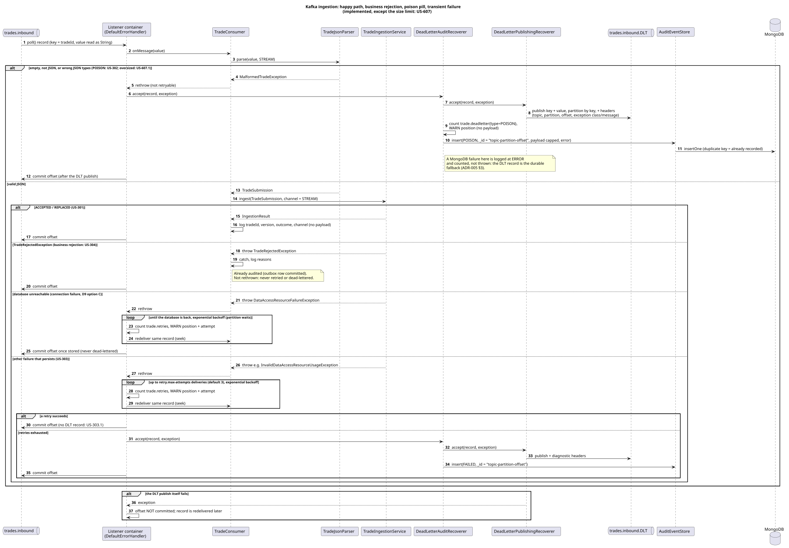
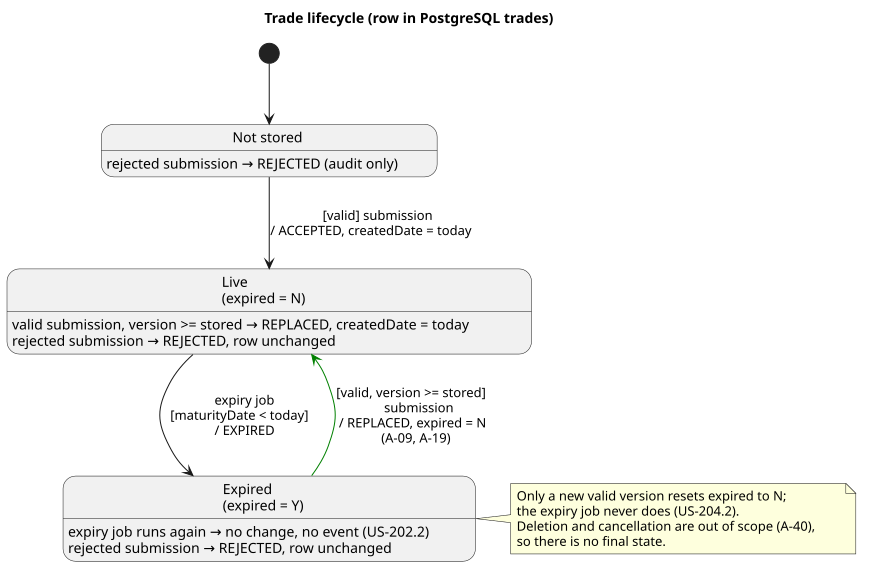
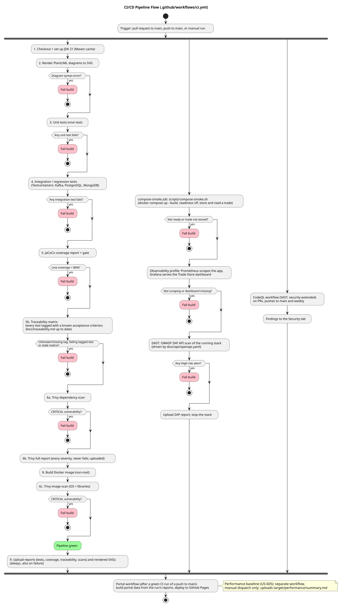

# Trade Store

**Project portal: https://kuldipkumar.github.io/Trade-store/** shows the whole journey in one view, from the BRD and backlog to tests, design, the database, the live pipeline, code, security scans and the observability dashboard. The REST API reference (Swagger UI) is at **https://kuldipkumar.github.io/Trade-store/api.html**.

## Overview

A service that receives trades from a **Kafka stream** and a **REST API**, applies the store rules, and keeps an append-only **audit trail** of every outcome. The rules:

- A trade with a **lower version** than the stored one is rejected.
- A trade with the **same version** replaces the stored one.
- A trade whose **maturity date** is before today is rejected.
- Trades are **marked expired** once their maturity date has passed.

Both channels run the same ingestion use case. PostgreSQL holds the latest version of each trade (the system of record). MongoDB holds the trade history and the audit trail, written through a transactional outbox, so a stored trade is never left unaudited.

| | |
|---|---|
| Stack | Java 21, Spring Boot 4.1, Kafka (KRaft), PostgreSQL 17 + Flyway, MongoDB 8, Testcontainers, GitHub Actions, Trivy, PlantUML |
| Assignment and requirements | [Requirements.md](Requirements.md), [docs/01-clarifications.md](docs/01-clarifications.md) |
| Backlog (6 epics, 32 stories) | [docs/02-backlog.md](docs/02-backlog.md) |
| Design | [docs/03-hld.md](docs/03-hld.md) (HLD), [docs/05-lld.md](docs/05-lld.md) (LLD), [docs/adr/](docs/adr/) (ADRs) |
| Requirement → story → test → code | [docs/traceability.md](docs/traceability.md) (generated, checked in CI), [docs/06-test-review.md](docs/06-test-review.md) |
| Operations | [Dead-letter runbook](docs/runbook-dead-letter.md) |
| How it was built | [AGENTS.md](AGENTS.md) (playbook), [PROMPTS.md](PROMPTS.md) (every AI prompt and the human decision), [docs/milestones.md](docs/milestones.md) |

## Architecture

One deployable Spring Boot application ([ADR-001](docs/adr/001-single-deployable-application.md)):





How a trade from the stream is handled, including rejections, poison pills, retries and the dead-letter topic:



Trade lifecycle:



The other diagrams are in [docs/diagrams/](docs/diagrams/), with PlantUML sources rendered to `docs/diagrams/out/`. They cover context, deployment, the CI pipeline, the classes, every main flow and the data model.

## Run locally

You need Docker. For development you also need JDK 21.

```bash
docker compose up --build -d          # app + Kafka + PostgreSQL + MongoDB
curl localhost:8080/actuator/health/readiness
```

`scripts/compose-smoke.sh` does the same and also stores and reads one trade. CI runs it on every pull request.

Try it:

```bash
# Submit over REST: 201 when new, 200 when it replaces the stored version
curl -i -X POST localhost:8080/trades -H 'Content-Type: application/json' \
  -d '{"tradeId":"T1","version":1,"counterPartyId":"CP-1","bookId":"B1","maturityDate":"2027-05-20"}'

# Publish to the stream, keyed by tradeId (the host listener is on 29092)
docker compose exec -T kafka /opt/kafka/bin/kafka-console-producer.sh --bootstrap-server localhost:9092 \
  --topic trades.inbound --property parse.key=true --property key.separator='|' <<'MSG'
T2|{"tradeId":"T2","version":1,"counterPartyId":"CP-2","bookId":"B1","maturityDate":"2027-05-20"}
MSG

curl localhost:8080/trades/T2                       # one trade
curl 'localhost:8080/trades?expired=false&size=20'  # paged list
curl localhost:8080/trades/T1/history               # every accepted version
curl 'localhost:8080/reports/audit?from=2026-11-01&to=2026-11-30&outcome=REJECTED'
curl -H 'Accept: text/csv' 'localhost:8080/reports/audit?tradeId=T1' -o audit.csv
curl localhost:8080/actuator/prometheus | grep '^trade_'
```

| Endpoint | Purpose | Errors |
|----------|---------|--------|
| `POST /trades` | Submit a trade | 400 invalid, 409 lower version, 422 maturity in the past, 413 too large, 503 database down |
| `GET /trades/{id}`, `GET /trades?expired&page&size` | Read the latest versions | 404, 400 |
| `GET /trades/{id}/history` | Every accepted version | 404 |
| `GET /reports/audit?from&to&tradeId&outcome&page&size` | Audit report as JSON (paged, with counts per outcome), or CSV with `Accept: text/csv` (streamed) | 400 |
| `/actuator/health/readiness`, `/actuator/prometheus` | UP only when PostgreSQL, MongoDB and Kafka are reachable; metrics | |

Settings live under `trade-store.*` ([LLD §6.4](docs/05-lld.md)). Every one can be overridden with an environment variable, for example `TRADE_STORE_TIME_ZONE=Asia/Kolkata`, `TRADE_STORE_EXPIRY_CRON`, `TRADE_STORE_RETRY_MAX_ATTEMPTS`, `TRADE_STORE_KAFKA_MAX_MESSAGE_BYTES`. Connections come from `POSTGRES_URL`, `POSTGRES_USER`, `POSTGRES_PASSWORD`, `MONGODB_URI` and `KAFKA_BOOTSTRAP_SERVERS`. The compose defaults are for local use only.

### Observability dashboard

```bash
docker compose --profile observability up --build -d   # adds Prometheus (localhost:9090) and Grafana (localhost:3000)
python3 scripts/load_trades.py --rate 100               # streams loadtest/trades-10k.csv into Kafka
```

Grafana opens on the provisioned **Trade Store** dashboard ([JSON](observability/grafana/dashboards/trade-store.json)). It shows:

- outcomes per minute, rejections by reason, and outcomes by channel
- trade-processing and HTTP latency (p50, p95, p99)
- dead letters, retries, outbox backlog, consumer lag and scheduled-job failures

### Load: the shared trade file

[`loadtest/trades-10k.csv`](loadtest/trades-10k.csv) holds 10,000 trade messages. Each row records the outcome the store must produce:

| Rows | Expected outcome |
|---:|---|
| 6,000 | New trades: `ACCEPTED` |
| 2,300 | Higher-version replacements and same-version resends: `REPLACED` |
| 800 | Lower versions: `REJECTED` (`LOWER_VERSION`) |
| 600 | Maturity dates in the past: `REJECTED` (`MATURITY_IN_PAST`) |
| 200 | Missing book ID: `REJECTED` (`INVALID_FIELD`) |
| 100 | Poison pills: sent to the dead-letter topic |

Each trade's rows are in version order, interleaved with other trades as on a real stream. The file is regenerated deterministically with `python3 scripts/generate_trades.py`. The same file drives the demos and the performance baseline (US-605).

```bash
python3 scripts/load_trades.py                                   # all 10,000 rows into Kafka at 500/s, keyed by tradeId
python3 scripts/load_trades.py --rate 50 --limit 1500            # a gentler demo
python3 scripts/load_trades.py --channel rest --rate 50 --limit 3000   # over REST; checks each status code
```

Each run prefixes the trade IDs (for example `L1124103000-T00001`), so every run starts fresh and gets the same outcomes. On Kafka it writes through the broker container's console producer, so it needs the compose stack running but no Python Kafka library.

## Run the tests

Tests need JDK 21 and a running Docker daemon. The integration tests use Testcontainers for Kafka, PostgreSQL and MongoDB, with no in-memory fakes.

```bash
./mvnw test                                   # unit tests only
./mvnw verify                                 # unit + integration tests + JaCoCo 80% line-coverage gate
./mvnw verify -DskipUnitTests=true -Dit.test=PoisonPillIT -Djacoco.skip=true   # one integration test class
python3 scripts/traceability.py               # regenerate docs/traceability.md (CI fails if it is stale)
scripts/render-diagrams.sh                    # render PlantUML to docs/diagrams/out
```

Every test is tagged with the acceptance criterion it proves (`@Tag("US-302.1")`). Each criterion is written as Given/When/Then, and the traceability matrix maps it to its tests and code.

## Pipeline

GitHub Actions ([.github/workflows/ci.yml](.github/workflows/ci.yml)) runs on every pull request and every push to `main`:



1. Checkout and JDK 21 setup, with a Maven cache.
2. Render every PlantUML diagram. A syntax error fails the build.
3. Unit tests.
4. Integration and regression tests on Testcontainers, then the JaCoCo gate (80% line coverage).
5. Traceability. A stale matrix, an unknown tag or a failing tagged test fails the build.
6. **Security:** CodeQL static analysis (SAST) runs in its own workflow on every PR, every push to `main` and weekly. OWASP ZAP scans the running API (DAST), driven by [the OpenAPI contract](docs/api/openapi.yaml), and any High-risk alert fails the build. Trivy scans the dependencies and the image. A **CRITICAL** finding (CVSS ≥ 9) fails the build ([ADR-006](docs/adr/006-trivy-oss-vulnerability-scan.md)). A full report of every severity is uploaded but never fails the build.
7. Build the Docker image, which runs as a non-root user.
8. Upload the test, coverage, traceability and scan reports, plus the rendered diagrams.
9. A separate `docker compose` job starts the whole stack, stores a trade, checks that Prometheus and Grafana work, and runs the ZAP scan.
10. After a green run on `main`, the **Portal** workflow publishes the project portal, with that run's reports, to GitHub Pages.

### Performance baseline (US-605)

These tests run on demand, through the *Performance baseline* workflow or `./mvnw verify -Pperformance -DskipUnitTests=true -Djacoco.skip=true`. Results on a single local instance on Testcontainers (2026-11-24), using `loadtest/trades-10k.csv`:

| Scenario | Result | Target (A-41) |
|---|---|---|
| Burst of the 10,000-message trade file | All processed in 11.1 s, every outcome as expected (6,000 accepted, 2,300 replaced, 1,600 rejected, 100 poison) | Within 60 s, zero loss |
| REST at 50 requests/s for 60 s | p50 5.6 ms, p95 8.6 ms, p99 21.0 ms, every status as expected | p95 < 200 ms |

## Assumptions

All 54 assumptions, each agreed with the product owner, are in [ASSUMPTIONS.md](ASSUMPTIONS.md); the open questions behind them are in [docs/01-clarifications.md](docs/01-clarifications.md). The ones that shape behaviour most:

- **"Today"** is the date in the configured time zone (A-16). A maturity date equal to today is accepted.
- **Expiry** runs daily at 00:05 and at startup to catch up. `expired` is a stored flag, so it can lag by up to the next run (A-18).
- **The stream is keyed by `tradeId`,** so a trade's versions stay in order (A-22).
- **Business rejections are final** and audited, never retried (A-26).
- **Unreadable messages** go straight to the dead-letter topic.
- **A database outage is waited out** and never dead-letters a trade. Other persistent failures are retried 3 times, then dead-lettered (A-28, decision D9).
- **The audit trail is append-only.** It is written through a transactional outbox, so it is never lost if MongoDB is briefly down (ADR-005).

## Known limitations

- History and the audit trail are **eventually consistent.** An entry appears once the outbox relay copies it to MongoDB, normally within a second.
- **Paging uses offset/skip,** which gets slower on deep pages. History is not paged.
- **The audit report's counts and its page come from two reads,** so the counts can lag by one entry that is relayed in between.
- **The DLT holds the message as text.** Bytes that aren't valid UTF-8 are not kept exactly, and oversized messages are truncated.
- **A CSV export client that stops reading for more than 10 minutes** hits MongoDB's idle cursor timeout. Exports may run for up to 30 minutes (`TRADE_STORE_EXPORT_TIMEOUT`).
- **Security controls are out of scope for this PoC** (decision D10, agreed 2026-11-23): there is no authentication, authorisation or TLS, and it runs as a single instance. The CodeQL, Trivy and ZAP scans still run and report on every change.

## Future improvements

- Keyset pagination for the trade list, the history and the audit report.
- Authentication and authorisation for the REST API and the actuator, plus TLS to Kafka and the databases.
- A schema registry (Avro or JSON Schema) for the stream contract.
- A replay tool for the dead-letter topic, so operators don't need console commands.
- Horizontal scaling: several instances, `kafka.concurrency` tuning and expiry with a distributed lock. Batches are already safe because of `SKIP LOCKED`.
- Alert rules on `trade_deadletter_total`, `trade_retries_total`, `trade_outbox_backlog_size` and consumer lag.
