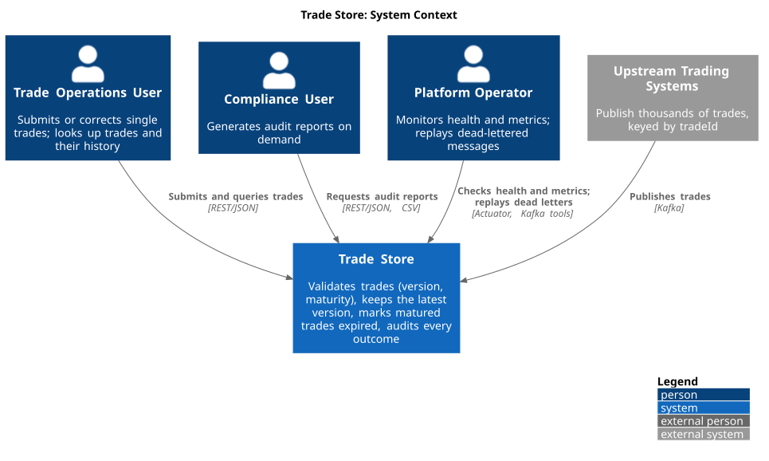
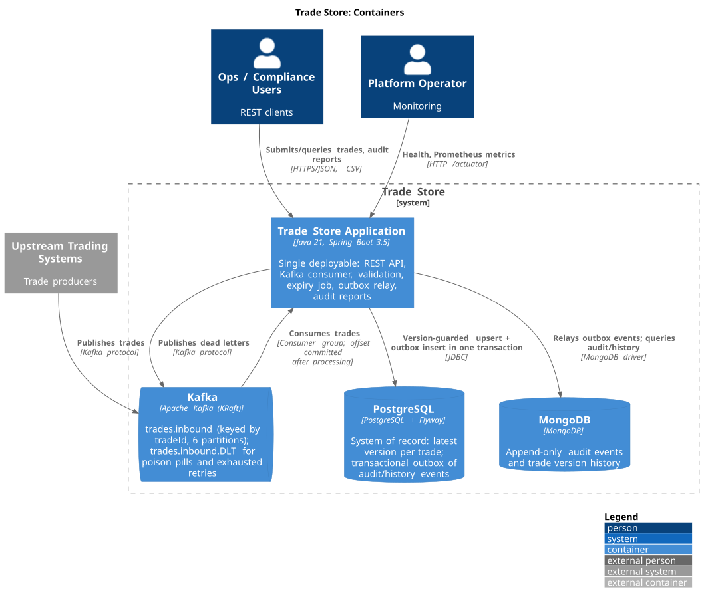
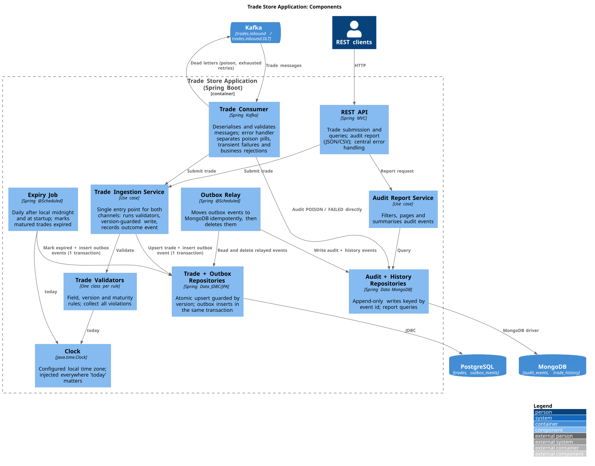
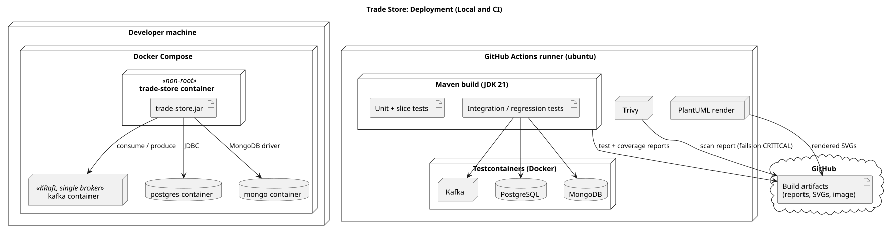

# Phase 3: High-Level Design

Inputs: [01-clarifications.md](01-clarifications.md), [ASSUMPTIONS.md](../ASSUMPTIONS.md), [02-backlog.md](02-backlog.md), and PO constraint **CR-6** in [02-po-review.md](02-po-review.md).
Diagram sources are in [diagrams/](diagrams/). The rendered SVGs are in [diagrams/out/](diagrams/out/).

## 1. Design summary

The Trade Store is **one Spring Boot application** (ADR-001) that receives trades from **Kafka** (the main channel) and **REST** (single trades and queries). Both channels call the **same ingestion service**. That service runs the validation rules and writes the latest version to **PostgreSQL** with a version-guarded upsert. In the **same transaction**, it records the outcome in an **outbox table**. An **outbox relay** copies outcomes into **MongoDB**, which holds the append-only audit trail and the trade history. A **scheduled expiry job** marks matured trades as expired. Unreadable messages and failures that persist after retries go to a **dead-letter topic**.

### Decisions

| ADR | Decision | Key reason |
|-----|----------|------------|
| [001](adr/001-single-deployable-application.md) | Single deployable Spring Boot app | KISS. No requirement for independent services. |
| [002](adr/002-kafka-for-trade-streaming.md) | Apache Kafka (KRaft) with Spring Kafka | Per-trade ordering by key, consumer groups, built-in dead-letter and retry handling |
| [003](adr/003-postgresql-system-of-record.md) | PostgreSQL + Flyway | Atomic version guard with `ON CONFLICT … WHERE`, and `RETURNING` for expiry |
| [004](adr/004-mongodb-audit-and-history.md) | MongoDB | Append-only documents of varying shape; aggregations for the report |
| [005](adr/005-transactional-outbox-for-audit.md) | Transactional outbox | Satisfies CR-6 (no lost audit entries) for all three event sources. Supersedes A-37. |
| [006](adr/006-trivy-oss-vulnerability-scan.md) | Trivy (dependencies + image) | One fast tool; fails the build on CRITICAL |
| [007](adr/007-spring-boot-4.md) | Spring Boot 4.1 (Spring Framework 7) | Spring Boot 3.5 / Framework 6.2 had CRITICAL CVEs with no free fix; upgraded before any business code existed |
| [008](adr/008-plain-jdbc-for-postgresql.md) | Spring `JdbcClient` for PostgreSQL (Phase 5) | Every write is PostgreSQL-specific SQL (guarded upsert, `RETURNING`, `SKIP LOCKED`); an ORM adds nothing |

## 2. System context

| Actor | Interaction |
|-------|-------------|
| Upstream trading systems | Publish trades to Kafka, **keyed by `tradeId`** (a producer contract) |
| Trade operations user | Submits and corrects trades, and queries trades and their history, over REST |
| Compliance user | Generates audit reports (JSON or CSV) |
| Platform operator | Health checks, metrics, and manual replay of dead-lettered messages |

## 3. Containers

| Container | Responsibility | Why it exists |
|-----------|----------------|---------------|
| Trade Store application | All business logic and both channels | Single deployable (ADR-001) |
| Kafka | `trades.inbound` (6 partitions, keyed by `tradeId`), `trades.inbound.DLT` | Required streaming tool. Ordering and dead letters (ADR-002). |
| PostgreSQL | `trades` (latest version), `outbox_events` | Required SQL store and system of record (ADR-003). Outbox (ADR-005). |
| MongoDB | `audit_events`, `trade_history` | Required NoSQL store. Audit and history (ADR-004). |

## 4. Components (inside the application)

| Component | Package | Responsibility | Main stories |
|-----------|---------|----------------|--------------|
| REST API | `api` | Endpoints, DTOs, `@ControllerAdvice` error shape | US-401 to US-404, US-502, US-503 |
| Trade Consumer + error handler | `messaging` | Listener, `ErrorHandlingDeserializer`, retry with backoff, recoverer to the dead-letter topic | US-301 to US-304, US-607 |
| Trade Ingestion Service | `service` | One use case for both channels: validate, guarded write, outbox event | US-101 to US-107, US-201 |
| Trade Validators | `service` | One class per rule (fields, version, maturity). All violations are collected. | US-104.4, US-105, US-201 |
| Expiry Job | `scheduler` | Cron (configurable) plus a run at startup. Idempotent update plus outbox events. | US-202 to US-204 |
| Outbox Relay | `scheduler` / `persistence` | Moves outbox events to MongoDB idempotently, then deletes them | US-501, CR-6 |
| Audit Report Service | `service` | Filters, paging, summary counts, CSV | US-502, US-503 |
| Repositories | `persistence/sql`, `persistence/nosql` | Guarded upsert, outbox, audit, history | All |
| Clock configuration | `config` | `Clock` in the configured local zone | US-205 |

## 5. Key flows

The detailed sequence diagrams, including failure paths, are drawn in Phase 5.

**5.1 Trade ingestion (Kafka or REST)**
1. The channel adapter parses the input. A failure on Kafka is a poison pill (5.4). A failure on REST returns `400`.
2. `TradeIngestionService` loads the stored version for the `tradeId` and runs all validators against `today` from the `Clock`.
3. **If any rule is violated:** it inserts a `REJECTED` outbox event with every reason, then raises one rejection exception carrying all the reasons (US-104.4). REST maps it to `409` or `422`. Kafka logs it, audits it, and commits the offset; it is not retried.
4. **If the trade is valid:** it runs the guarded upsert and inserts an `ACCEPTED`/`REPLACED` outbox event, **in one transaction**. If 0 rows are updated (a concurrent higher version), it re-validates, which produces `LOWER_VERSION` (US-106).
5. Kafka commits the offset after the transaction commits. REST returns `201` or `200`.

**5.2 Outbox relay.** Every 1 s (configurable) the relay claims a batch with `FOR UPDATE SKIP LOCKED`. It writes each event to `audit_events` (and to `trade_history` for accepted and replaced events), with `_id` = the event ID, which makes the write idempotent. Then it deletes the relayed rows.

**5.3 Expiry.** The job runs on a cron (default shortly after local midnight) and once at startup. A single `UPDATE … WHERE maturity_date < today AND expired = false RETURNING …` statement marks the trades. `EXPIRED` outbox events are inserted in the same transaction. Running it again changes nothing.

**5.4 Poison pills and transient failures (Kafka)**
- **Deserialisation or schema failure, or a message over 1 MB:** not retried. The message is published to `trades.inbound.DLT` with diagnostic headers, and a `POISON` event is written directly to MongoDB.
- **Transient failure (for example, a database outage):** up to 3 attempts with exponential backoff, then the dead-letter topic plus a `FAILED` event.
- The offset is committed only after the dead-letter publish succeeds (ADR-005 §3).

**5.5 Audit report.** `GET /reports/audit` with filters `from`/`to` (local dates converted to UTC), `tradeId` and `outcome`. Results are paged. Summary counts come from an aggregation. `Accept: text/csv` streams CSV.

## 6. Interfaces (high level; contracts are detailed in Phase 5)

| Interface | Shape |
|-----------|-------|
| Kafka `trades.inbound` | Key: `tradeId`. Value: JSON `{tradeId, version, counterPartyId, bookId, maturityDate (yyyy-MM-dd)}`. Unknown fields are ignored. Maximum size 1 MB. |
| Kafka `trades.inbound.DLT` | The original bytes, plus headers for the original topic, partition, offset, exception class and message |
| REST | `POST /trades`, `GET /trades/{id}`, `GET /trades?page&size&expired`, `GET /trades/{id}/history`, `GET /reports/audit` |
| Errors (REST) | `{timestamp, status, error, reasons[], path}`: 400 invalid, 404 not found, 409 lower version, 413 too large, 422 past maturity |
| Operations | `/actuator/health/{liveness,readiness}`, `/actuator/prometheus` |

## 7. How the non-functional requirements are met

| NFR | Design response |
|-----|-----------------|
| A-41 Performance | Kafka partitions and consumer concurrency. One SQL statement per trade. The relay works in batches, so audit writes are off the hot path. |
| A-42 Scalability | The app is stateless; consumers scale up to the partition count. The expiry job is idempotent, and the relay uses `SKIP LOCKED`. |
| A-43 Resilience | Offsets are committed manually after processing, shutdown is graceful, and retries use backoff. |
| A-44 Durability | Local ACID transaction for trade plus outbox. History and audit are eventually consistent. |
| A-45 Audit integrity | Append-only collections with no update or delete paths. Event-ID keys make writes idempotent. |
| CR-6 No lost audit | Outbox (ADR-005). The dead-letter record is the fallback for `POISON` and `FAILED` events. |
| A-46 Observability | Actuator health covering PostgreSQL, MongoDB and Kafka. Micrometer counters for outcomes, the processing timer, dead-letter count, and outbox backlog gauges. Structured logs containing IDs only. |
| A-47 Security | Trivy gate on dependencies and the image. Non-root image. Credentials from environment variables. 1 MB limits on REST and Kafka. |
| A-49 Deployability | Docker Compose: app, Kafka, PostgreSQL, MongoDB ([deployment diagram](#8-deployment)). |
| A-50 Configurability | `trade-store.*` properties: topics, partitions, retry policy, expiry cron, relay interval, time zone, size limits. |
| A-52 Capacity | Unique key on `trade_id`, partial index on `maturity_date` for unexpired trades, MongoDB indexes for report filters, paged queries. |
| A-53 Time | A `Clock` in the configured zone for business dates. Timestamps are stored as UTC instants. |

## 8. Deployment

- **Local:** `docker compose up` starts the app image (running as non-root), Kafka (KRaft, single broker), PostgreSQL and MongoDB. Image versions are pinned in Phase 4.
- **CI (GitHub Actions):** Maven on JDK 21. Unit and slice tests, then integration tests on Testcontainers. JaCoCo gate. Trivy scans of the file system and the image. PlantUML rendering. Reports and SVGs are uploaded as artifacts.

## 9. Risks and trade-offs

| Risk / trade-off | Mitigation |
|------------------|------------|
| Audit lags trade state by about the relay interval | Interval is configurable. Outbox backlog gauge. Tests use Awaitility. |
| A producer that doesn't key by `tradeId` breaks per-trade ordering | Documented producer contract. The guarded upsert still prevents a lower version from overwriting a higher one. |
| Redelivery after a crash produces a second `REPLACED` event and resets `createdDate` | Accepted (A-08, A-24). Listed as a known limitation. |
| If both PostgreSQL and MongoDB are down, a `FAILED` audit entry may be missing | The dead-letter record holds the message (the offset is committed only after the dead-letter publish). Replay runbook (US-609.2). |
| No authentication on the REST and report endpoints | Out of scope (A-39). Top of the known limitations. |

## 10. Assumption changes from this phase
- **A-37** (SQL first, then audit with retry) is **superseded by ADR-005** (transactional outbox), as required by CR-6.

## 11. Gate check (AGENTS.md: Phase 3)
- [x] Components defined, each with a reason to exist.
- [x] Technology choices justified in ADRs 001 to 006, approved by the human on 2026-11-20.
- [x] Context, container, component and deployment diagrams in PlantUML. They render with no syntax errors (checked with PlantUML 1.2026.10).
- [ ] Human approval of this HLD.
