# Phase 5: Low-Level Design

Inputs: [02-backlog.md](02-backlog.md) (the acceptance criteria), [03-hld.md](03-hld.md), ADRs [001](adr/001-single-deployable-application.md)–[008](adr/008-plain-jdbc-for-postgresql.md), [ASSUMPTIONS.md](../ASSUMPTIONS.md).
Diagram sources are in [diagrams/](diagrams/) (`05-*.puml`), and the rendered SVGs are in [diagrams/out/](diagrams/out/).

**Scope:** class structure, flows, data model, contracts and error handling, detailed enough that each acceptance criterion maps to a class and a flow. This phase contains no production code. Phase 6 builds it story by story with TDD.

---

## 1. Package layout and class responsibilities

Base package: `com.tradestore`. The structure follows AGENTS.md §7. Services depend only on interfaces (ports) in `persistence`; adapters implement them (Dependency Inversion).

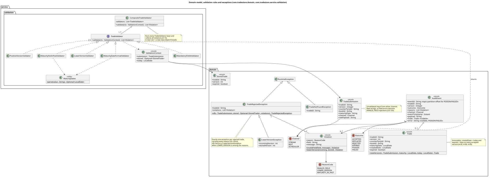

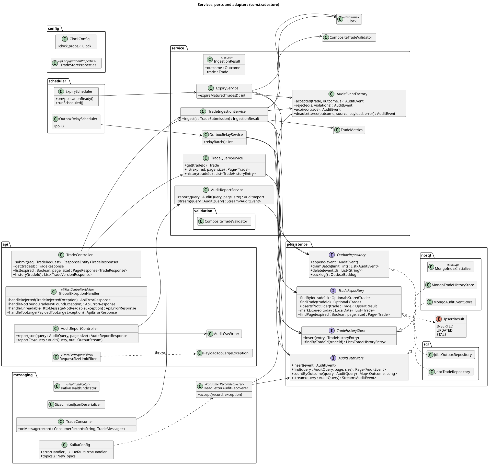

| Package | Class | Responsibility |
|---------|-------|----------------|
| `domain` | `Trade` (record) | A valid, immutable stored trade. `newVersion(...)` sets `createdDate = today` and `expired = false` (A-05, A-08, A-09). |
| | `TradeSubmission` (record) | Unvalidated input from either channel. `maturityDate` is a raw `String` and `version` is an `Integer`, so field problems become `INVALID_FIELD` rejections instead of parse errors. |
| | `StoredTrade` (record) | The minimal stored view used by validation: `tradeId`, `version`, `expired`. |
| | `Violation` (record), `ReasonCode` (enum) | One broken rule: `reason`, `field`, `message`. |
| | `Outcome`, `Channel` (enums) | `ACCEPTED, REPLACED, REJECTED, EXPIRED, POISON, FAILED`; `STREAM, REST, SCHEDULER`. |
| | `AuditEvent` (record) | One audit-trail entry (the outbox payload and the MongoDB document). `error` is set only for `POISON`/`FAILED`; their `eventId` is the message's `topic-partition-offset` (§6.3). *The planned `DeadLetterSource` record was not needed: the position is the ID and the DLT headers carry the rest.* |
| | `TradeRejectedException`, `LowerVersionException` | One exception per rejected trade, carrying all violations (§3). |
| | `TradeNotFoundException` | Unknown `tradeId` on the read side (404). |
| `service` | `TradeIngestionService` | The single use case for both channels (§4.1). Owns the transaction. |
| | `TradeQueryService` | Get, list and history reads. |
| | `ExpiryService` | Marks matured trades expired and writes `EXPIRED` outbox events in one transaction. |
| | `OutboxRelayService` | Moves one batch of outbox events to MongoDB. |
| | `AuditReportService` | Report page, summary counts and CSV stream. |
| | `AuditEventFactory` | Builds `AuditEvent`s: event ID (UUID), UTC timestamp from the `Clock`, payload capped at `audit.max-payload-chars`. |
| | `TradeMetrics` | Micrometer meters (§8). |
| `service.validation` | `TradeValidator` (interface) and 5 implementations | **One class per rule** (AGENTS.md §4): `MandatoryFieldsValidator`, `PositiveVersionValidator`, `MaturityDateFormatValidator`, `LowerVersionValidator`, `MaturityNotInPastValidator`. |
| | `CompositeTradeValidator` | Runs every `TradeValidator` bean and collects all violations (A-15). A new rule is a new bean (Open/Closed). |
| | `MaturityDates` | Strict `yyyy-MM-dd` parsing (`ResolverStyle.STRICT`, so `2026-02-30` is invalid). |
| `service.parsing` | `TradeJsonParser`, `MalformedTradeException` | Strict trade JSON for both channels: text fields must be JSON strings, `version` a whole number; nothing is coerced. The original text is kept as the audit payload. |
| `persistence` | `TradeRepository`, `OutboxRepository`, `AuditEventStore`, `TradeHistoryStore` | Ports (interfaces). |
| `persistence.sql` | `JdbcTradeRepository`, `JdbcOutboxRepository` | `JdbcClient` adapters ([ADR-008](adr/008-plain-jdbc-for-postgresql.md)). |
| `persistence.nosql` | `MongoAuditEventStore`, `MongoTradeHistoryStore` | `MongoTemplate` adapters. Insert-only. A duplicate key counts as success. |
| `messaging` | `TradeConsumer` | `@KafkaListener` on `trades.inbound`: reads the message as **text**, parses it with the shared strict `TradeJsonParser` (raw text kept for the audit), calls the ingestion service. *Simplification of the original design (US-301): no custom deserializer; unparseable messages surface as `MalformedTradeException` in the listener and are dead-lettered as poison pills (US-302).* |
| | `SizeLimitedJsonDeserializer` (US-607) | Rejects payloads over `kafka.max-message-bytes` before parsing. Wrapped by `ErrorHandlingDeserializer`. |
| | `DeadLetterAuditRecoverer` | Publishes to the dead-letter topic (delegating to `DeadLetterPublishingRecoverer`; partition chosen by key), then counts `trade.deadletter{type}`, logs one WARN line (`outcome=POISON|FAILED position=… error=<class>`, no payload) and writes the audit entry directly to MongoDB (not through the outbox: there is no trade transaction). A failed publish propagates (offset not committed, redelivered); a failed audit write is logged at ERROR and counted (`trade.deadletter.audit.failures`), not thrown. `POISON` when the cause is `MalformedTradeException`, otherwise `FAILED` (retries exhausted). |
| | `KafkaConfig` | Topics (`NewTopic`: `trades.inbound` and `trades.inbound.DLT` with the same partition count, from `trade-store.kafka.*`, default 6 partitions / 1 replica; **never increase partitions on a live topic**, it reorders keys) and the `DefaultErrorHandler`: `MalformedTradeException` not retried; other failures retried with exponential backoff from `trade-store.retry.*` (default 3 deliveries in total, 1 s ×2 up to 10 s), then dead-lettered as `FAILED` (US-303). |
| | `KafkaHealthIndicator` | `describeCluster` with a timeout; part of the readiness group (US-604.1). |
| `api` | `TradeController`, `AuditReportController` | HTTP endpoints (§6.1). |
| | DTO records | `TradeResponse`, `TradeVersionResponse`, `PageResponse<T>`, `AuditReportResponse`, `ApiErrorResponse` (with `Reason`). |
| | `GlobalExceptionHandler` | `@RestControllerAdvice`: one error shape, status mapping (§7). |
| | `RequestSizeLimitFilter` | Returns 413 for bodies over `api.max-request-bytes`, by `Content-Length` and by counting streamed bytes (chunked requests). |
| | `AuditCsvWriter` | Writes the CSV header and rows (RFC 4180 quoting). |
| `scheduler` | `ExpiryScheduler` | `@Scheduled(cron, zone)` plus `@EventListener(ApplicationReadyEvent)` (US-203). |
| | `OutboxRelayScheduler` | `@Scheduled(fixedDelayString = outbox.poll-interval)`. |
| `config` | `TradeStoreProperties` | `@ConfigurationProperties("trade-store")`, validated at startup (§6.4). |
| | `ClockConfig` | `Clock.system(zone)`; the zone comes from `trade-store.time-zone`, or the server default if unset (A-16, US-205). |

**Conventions** (AGENTS.md §4, §8): constructor injection only; records for DTOs and value objects; no `LocalDate.now()` without the injected `Clock`; logs carry IDs and outcomes, never the full payload (A-32).

## 2. Main flows (sequence diagrams)

| Flow | Diagram | Stories |
|------|---------|---------|
| Ingestion use case (shared by both channels) | [05-seq-trade-ingestion](diagrams/out/05-seq-trade-ingestion.svg) | US-101 to US-107, US-201, US-205 |
| Kafka: happy path, rejection, poison pill, retry then dead-letter | [05-seq-stream-ingestion](diagrams/out/05-seq-stream-ingestion.svg) | US-301 to US-304, US-607 |
| REST submission and status mapping | [05-seq-rest-submit](diagrams/out/05-seq-rest-submit.svg) | US-401 |
| Outbox relay to MongoDB | [05-seq-outbox-relay](diagrams/out/05-seq-outbox-relay.svg) | US-501, CR-6 |
| Expiry (at startup and on the cron) | [05-seq-expiry](diagrams/out/05-seq-expiry.svg) | US-202 to US-204 |
| Trade queries and audit report | [05-seq-queries-and-report](diagrams/out/05-seq-queries-and-report.svg) | US-402 to US-404, US-502, US-503 |

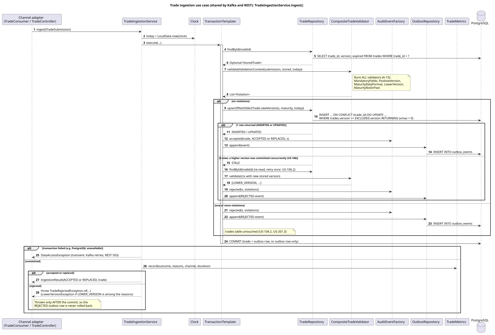
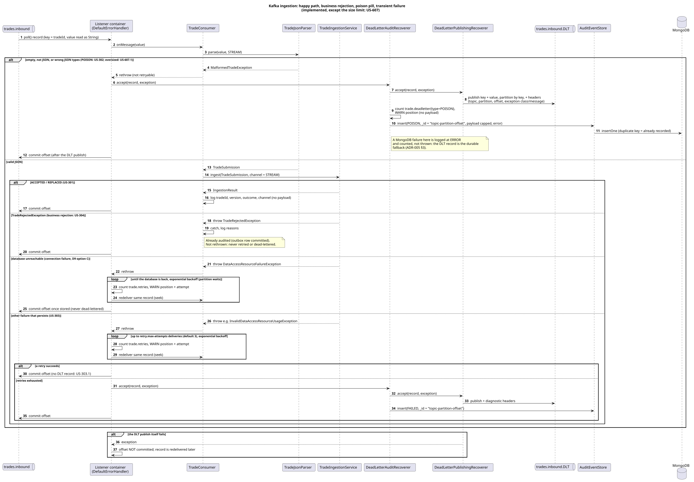
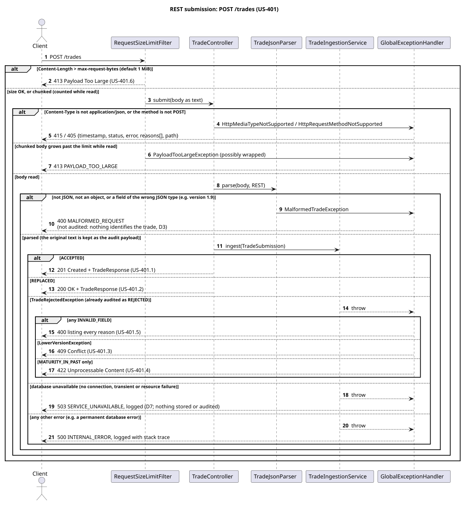
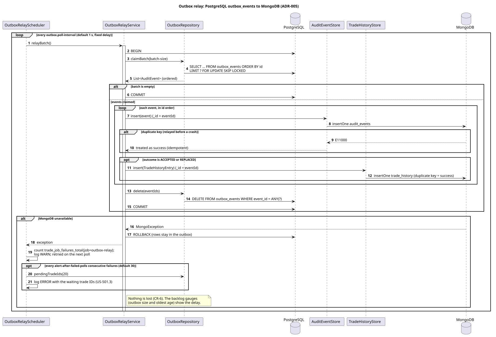
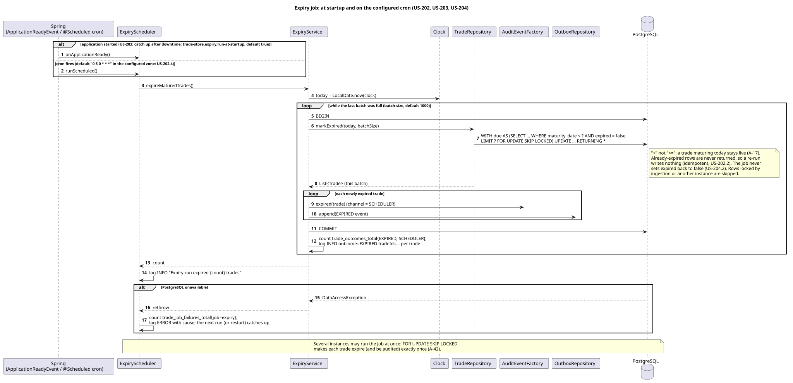
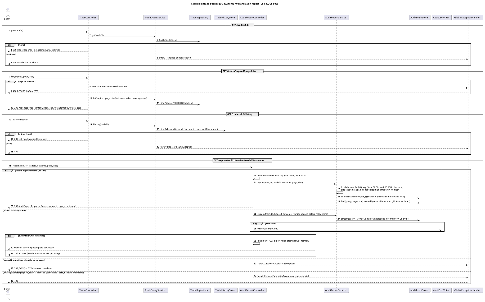

## 3. Rejections: one exception, all reasons (US-104.4)

- `CompositeTradeValidator` returns **every** violation (A-15). Each validator **skips checks whose inputs are invalid**, so one bad field never adds a misleading second reason. For example, an unparseable maturity date gives `INVALID_FIELD` only, not also `MATURITY_IN_PAST`.
- `TradeRejectedException.of(submission, stored, violations)` is the only way to build a rejection. It returns a **`LowerVersionException`** (a subclass) when `LOWER_VERSION` is among the reasons, and a plain `TradeRejectedException` otherwise. So a lower-version trade with a past maturity raises one `LowerVersionException` that carries both reasons (US-201.4).
- `LowerVersionException.getMessage()` names both versions: `"Trade T2 version 1 is lower than stored version 2"` (US-104.1).
- **The exception is thrown after the transaction commits.** The service runs its database work in a `TransactionTemplate` that returns a result, and throws only afterwards, so the `REJECTED` outbox row is never rolled back. (`@Transactional(noRollbackFor = …)` was rejected as easy to break silently.)

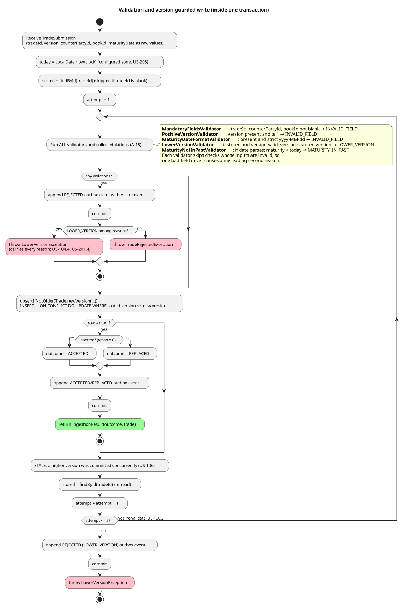

## 4. Key algorithms

### 4.1 Version-guarded write (US-102, US-103, US-104, US-106)
```sql
INSERT INTO trades (trade_id, version, counter_party_id, book_id, maturity_date, created_date, expired, updated_at)
VALUES (:tradeId, :version, :cp, :book, :maturity, :today, false, now())
ON CONFLICT (trade_id) DO UPDATE
   SET version = EXCLUDED.version, counter_party_id = EXCLUDED.counter_party_id, book_id = EXCLUDED.book_id,
       maturity_date = EXCLUDED.maturity_date, created_date = EXCLUDED.created_date,
       expired = false, updated_at = now()
 WHERE trades.version <= EXCLUDED.version
RETURNING (xmax = 0) AS inserted;
```
- **No row returned:** `STALE`. A higher version was committed concurrently. The service re-reads, re-validates and tries at most once more (US-106.2). The re-validation produces `LOWER_VERSION`.
- **`inserted = true`:** `ACCEPTED`. **`false`:** `REPLACED`. (`xmax = 0` is the standard PostgreSQL way to tell an insert from an update in an upsert. It is covered by a Testcontainers test, so a behaviour change in PostgreSQL would be caught.)
- An identical redelivery is a `REPLACED` that resets only `created_date` (US-103.2, A-24).

### 4.2 Expiry (US-202)
In bounded batches (`trade-store.expiry.batch-size`, default 1000), one transaction per batch, repeated while a batch comes back full:
```sql
WITH due AS (SELECT trade_id FROM trades
              WHERE maturity_date < :today AND expired = false
              ORDER BY maturity_date, trade_id LIMIT :limit
                FOR UPDATE SKIP LOCKED)
UPDATE trades t SET expired = true, updated_at = now() FROM due
 WHERE t.trade_id = due.trade_id
RETURNING t.*;
```
Each returned row becomes an `EXPIRED` outbox event in the same transaction. Batching keeps a large backlog (for example the startup catch-up after downtime) from locking every matured trade at once; `SKIP LOCKED` lets expiry and ingestion, or several instances, run side by side. It is idempotent: already-expired rows are never returned. (Changed from a single unbounded `UPDATE` after the US-202 code review.)

### 4.3 Outbox relay (ADR-005)
Claim with `SELECT … ORDER BY id LIMIT :batch FOR UPDATE SKIP LOCKED`. Then insert into MongoDB with `_id = eventId` (a duplicate key counts as success), then `DELETE … WHERE event_id = ANY(:ids)`, then commit. If MongoDB fails, the transaction rolls back and the rows stay for the next poll.

## 5. Trade lifecycle and data model

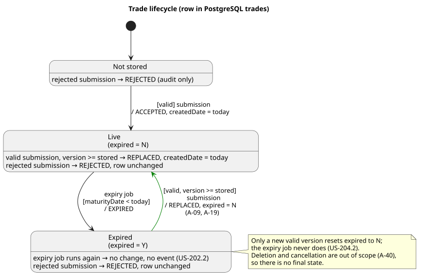

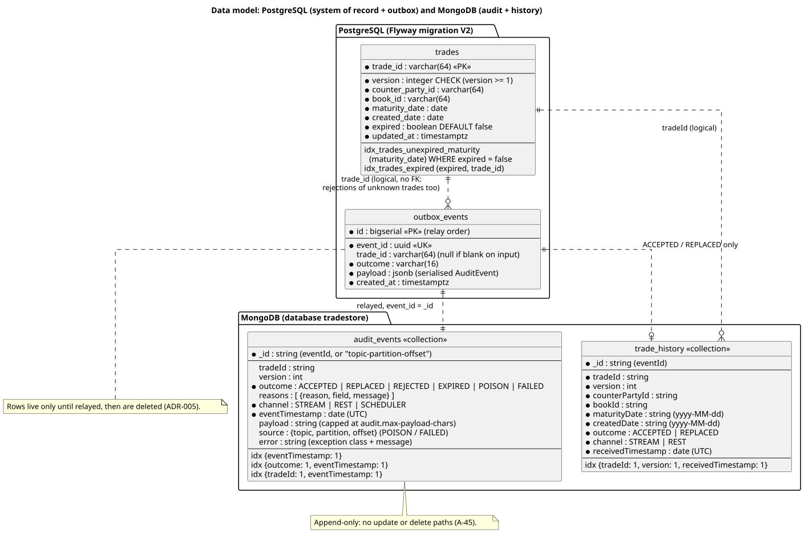

**PostgreSQL migration `V2__trades_and_outbox.sql`** (written in Phase 6 with the first story that needs it):
```sql
CREATE TABLE trades (
    trade_id         VARCHAR(64) PRIMARY KEY,
    version          INTEGER     NOT NULL CHECK (version >= 1),
    counter_party_id VARCHAR(64) NOT NULL,
    book_id          VARCHAR(64) NOT NULL,
    maturity_date    DATE        NOT NULL,
    created_date     DATE        NOT NULL,
    expired          BOOLEAN     NOT NULL DEFAULT FALSE,
    updated_at       TIMESTAMPTZ NOT NULL
);
CREATE INDEX idx_trades_unexpired_maturity ON trades (maturity_date) WHERE expired = FALSE;  -- expiry (A-52)
CREATE INDEX idx_trades_expired ON trades (expired, trade_id);                                -- GET /trades?expired=

CREATE TABLE outbox_events (
    id         BIGSERIAL   PRIMARY KEY,
    event_id   UUID        NOT NULL UNIQUE,
    trade_id   VARCHAR(64),
    outcome    VARCHAR(16) NOT NULL,
    payload    JSONB       NOT NULL,
    created_at TIMESTAMPTZ NOT NULL
);
```
- The 64-character limit on IDs is enforced by `MandatoryFieldsValidator` as well, so an over-long ID is an `INVALID_FIELD` rejection and never a database error.
- **MongoDB indexes** are created at startup by `MongoIndexInitializer` (`ensureIndex`, idempotent): `audit_events {eventTimestamp}`, `{outcome, eventTimestamp}`, `{tradeId, eventTimestamp}`; `trade_history {tradeId, version, receivedTimestamp}`.

## 6. Contracts

### 6.1 REST API
| Method and path | Request | Success | Errors |
|-----------------|---------|---------|--------|
| `POST /trades` | `TradeRequest` | `201` new trade, `200` replacement; body `TradeResponse` | 400, 409, 413, 422, 503 |
| `GET /trades/{tradeId}` | | `200 TradeResponse` | 404 |
| `GET /trades?expired={bool}&page=0&size=20` | `size` capped at `api.max-page-size` (100); `page ≥ 0`, `size ≥ 1` | `200 PageResponse<TradeResponse>` sorted by `tradeId` (`COLLATE "C"`, code-point order); page and total from one query (`count(*) OVER ()`) | 400 `INVALID_PARAMETER` |
| `GET /trades/{tradeId}/history` | | `200 [TradeVersionResponse]` sorted by version, then received time | 404 |
| `GET /reports/audit?from&to&tradeId&outcome&page&size` | All optional. `from`/`to`: local dates, inclusive, in the configured zone (queried as `[from 00:00, to+1 00:00)`); `size` default 50, capped at `api.max-page-size`; entries oldest first; `summary` and `totalElements` come from one `$group` aggregation | `200 AuditReportResponse` (JSON) or `text/csv` (by `Accept`) | 400 |

```jsonc
// TradeRequest (and the Kafka TradeMessage): unknown fields are ignored
{ "tradeId": "T1", "version": 1, "counterPartyId": "CP-1", "bookId": "B1", "maturityDate": "2027-05-20" }

// TradeResponse
{ "tradeId": "T1", "version": 1, "counterPartyId": "CP-1", "bookId": "B1",
  "maturityDate": "2027-05-20", "createdDate": "2026-11-19", "expired": false }

// TradeVersionResponse
{ "tradeId": "T2", "version": 2, "counterPartyId": "CP-2", "bookId": "B1", "maturityDate": "2027-05-20",
  "createdDate": "2026-11-19", "outcome": "REPLACED", "channel": "STREAM", "receivedTimestamp": "2026-11-19T10:15:30Z" }

// PageResponse<T>
{ "content": [ ... ], "page": 0, "size": 10, "totalElements": 25, "totalPages": 3 }

// AuditReportResponse
{ "summary": { "ACCEPTED": 2, "REJECTED": 2, "EXPIRED": 2 },
  "entries": [ { "eventId": "…", "tradeId": "T2", "version": 1, "outcome": "REJECTED",
                 "reasons": [ { "reason": "LOWER_VERSION", "field": "version", "message": "…" } ],
                 "channel": "REST", "eventTimestamp": "2026-11-19T10:15:30Z", "payload": "{…}",
                 "error": null } ],                // error: set for POISON / FAILED only
  "page": 0, "size": 50, "totalElements": 6, "totalPages": 1 }

// ApiErrorResponse (every error)
{ "timestamp": "2026-11-19T10:15:30Z", "status": 409, "error": "Conflict",
  "reasons": [ { "reason": "LOWER_VERSION", "field": "version", "message": "Trade T2 version 1 is lower than stored version 2" } ],
  "path": "/trades" }
```
**CSV columns:** `eventId,eventTimestamp,tradeId,version,outcome,channel,reasons`. Reasons are joined with `;`. The payload is excluded from the CSV to keep it readable.

### 6.2 Kafka
| Item | Contract |
|------|----------|
| `trades.inbound` | Key: `tradeId` (UTF-8 string). Value: JSON `TradeMessage` (same shape as `TradeRequest`). Producers **must** key by `tradeId` (A-22). |
| Consumer | Group `trade-store`; `enable.auto.commit=false`; container `AckMode.BATCH` (offsets committed after the records in a poll are processed or recovered); concurrency `kafka.concurrency` (default 3, ≤ partitions). |
| Not retryable | `MalformedTradeException` (empty, not JSON, wrong types), `IllegalArgumentException`, and Spring's built-in set (`DeserializationException`, `MessageConversionException`, `ConversionException`, `MethodArgumentResolutionException`, `NoSuchMethodException`, `ClassCastException`), anywhere in the cause chain. All are dead-lettered at once and audited `POISON` (`KafkaConfig.isUnreadable`); every other exception is retried and, when the attempts run out, audited `FAILED`. `TradeRejectedException` never reaches the handler (US-304). |
| Retryable | Everything else (for example `DataAccessException`): `ExponentialBackOff` from `retry.initial-interval` (1 s) × `retry.multiplier` (2.0) up to `retry.max-interval` (10 s), **`retry.max-attempts` = 3 deliveries in total**. |
| `trades.inbound.DLT` (`kafka.dlt-topic`, default `<topic>.DLT`) | The original key and the value **as text** (the listener reads UTF-8; bytes that are not valid UTF-8 are not preserved exactly, see known limitations). Spring headers `kafka_dlt-original-topic`, `-partition`, `-offset`, `-exception-fqcn`, `-exception-message` (US-302.3). The partition is chosen by the producer from the key, so it always exists on the DLT; the original partition is in the header. |

### 6.3 Audit event IDs
- Outcomes recorded through the outbox use a random UUID `eventId`, so a redelivered message produces a second, accurate event (A-24).
- `POISON` and `FAILED` use `"<topic>-<partition>-<offset>"`. It is deterministic, so a re-run of the recoverer can't duplicate the entry. ADR-005 says "a hash"; a readable composite key gives the same guarantee and is easier to search.

### 6.4 Configuration (`trade-store.*`, all overridable by environment variables)
| Property | Default | Story |
|----------|---------|-------|
| `time-zone` | *(empty = server default)* | US-205 |
| `kafka.topic` / `kafka.dlt-topic` | `trades.inbound` / `trades.inbound.DLT` | US-301 |
| `kafka.partitions` / `kafka.replication-factor` / `kafka.concurrency` | `6` / `1` / `3` | A-42 |
| `kafka.max-message-bytes` | `1048576` | US-607.1 |
| `retry.max-attempts` / `retry.initial-interval` / `retry.multiplier` / `retry.max-interval` | `3` / `1s` / `2.0` / `10s` | US-303.3 |
| `expiry.cron` / `expiry.batch-size` | `0 5 0 * * *` / `1000` | US-202.4 |
| `expiry.run-at-startup` / `expiry.startup-retry-interval` / `expiry.startup-max-attempts` | `true` / `1m` / `10` | US-203 |
| `outbox.poll-interval` / `outbox.batch-size` / `outbox.alert-after-failed-polls` | `1s` / `500` / `30` | ADR-005, US-501.3 |
| `audit.max-payload-chars` | `10000` | US-302.2 |
| `api.max-request-bytes` / `api.max-page-size` | `1048576` / `100` | US-401.6, US-403 |

## 7. Error-handling strategy

| Situation | Exception | REST | Kafka | Audited as |
|-----------|-----------|------|-------|------------|
| Body over the size limit | `PayloadTooLargeException` / `DeserializationException` | 413 | DLT, no retry | `POISON` (Kafka only) |
| Not JSON, or wrong JSON types | `HttpMessageNotReadableException` / `DeserializationException` | 400 | DLT, no retry | `POISON` (Kafka only; see D3) |
| Any `INVALID_FIELD` | `TradeRejectedException` | **400** | Offset committed, no retry | `REJECTED` |
| `LOWER_VERSION` (and no invalid field) | `LowerVersionException` | **409** | Offset committed, no retry | `REJECTED` |
| `MATURITY_IN_PAST` only | `TradeRejectedException` | **422** | Offset committed, no retry | `REJECTED` |
| Out-of-range query parameter (page < 0, size < 1) | `InvalidRequestParameterException` | 400 `INVALID_PARAMETER` | n/a | n/a |
| Unknown trade on the read side, or unknown path | `TradeNotFoundException`, `NoResourceFoundException` | 404 | n/a | n/a |
| Database unavailable (no connection, transient or resource failure) | `CannotCreateTransactionException`, `TransientDataAccessException`, `DataAccessResourceFailureException` | 503, logged | Retry with backoff, then DLT | `FAILED` (Kafka only) |
| Unsupported content type / method | `HttpMediaTypeNotSupportedException` / `HttpRequestMethodNotSupportedException` | 415 / 405 | n/a | n/a |
| MongoDB unavailable during relay | `MongoException` | n/a | n/a | Delayed, never lost: rows stay in the outbox |
| Other Spring MVC client errors (406, missing parameter, …) | `ErrorResponse` exceptions | their own 4xx (406 without a body), logged at DEBUG | n/a | n/a |
| Anything else, including permanent database errors | `Exception` | 500 `INTERNAL_ERROR` (generic message, logged with stack trace) | Retry, then DLT | `FAILED` |

**Status precedence when a trade breaks several rules:** 400 (the request itself must be fixed) > 409 > 422. The response always lists **all** reasons.

## 8. Observability (US-604)

| Signal | Name and tags |
|--------|---------------|
| Counter | `trade_outcomes_total{outcome, reason, channel}`: one increment per reason for rejections |
| Timer | `trade_processing_seconds{channel}`: ingestion use case latency |
| Counter | `trade_deadletter_total{type=POISON\|FAILED}` |
| Counter | `trade_retries_total`: stream redeliveries scheduled after a transient failure (each logged at WARN with `position=topic-partition-offset attempt=n of max` and the cause class) |
| Counter | `trade_deadletter_audit_failures_total`: dead letters whose audit entry could not be written (logged at ERROR with the position; the DLT record remains) |
| Counter | `trade_job_failures_total{job}`: failed runs of a scheduled job: `expiry` (each logged at ERROR) and `outbox-relay` (each logged at WARN; every `outbox.alert-after-failed-polls` consecutive failures, ERROR with the waiting trade IDs) |
| Gauges | `trade_outbox_backlog_size`, `trade_outbox_oldest_age_seconds` |
| Kafka lag | Micrometer's Kafka client metrics (`kafka_consumer_fetch_manager_records_lag_max`) |
| Health | `readiness` group = `db`, `mongo`, `kafka` (`KafkaHealthIndicator`) (US-604.1); `liveness` = the application state only |
| Logs | One INFO line per trade (ingestion and expiry, `channel=SCHEDULER` for the latter): `outcome=REJECTED tradeId=T2 version=1 channel=STREAM reasons=[LOWER_VERSION]`. MDC holds `tradeId` and `channel`. No payloads (A-32). |

## 9. Test design (Phase 6 and 7)

| Layer | Tests | Infrastructure |
|-------|-------|----------------|
| Validators, `TradeRejectedException.of`, `Trade`, `MaturityDates`, `AuditEventFactory` | Unit (most tests) | None. Fixed `Clock`. |
| `TradeIngestionService`, `ExpiryService`, `OutboxRelayService`, `AuditReportService` | Unit with Mockito on the ports | None |
| `TradeController`, `AuditReportController`, `GlobalExceptionHandler`, `RequestSizeLimitFilter` | `@WebMvcTest` slices | None |
| `JdbcTradeRepository`, `JdbcOutboxRepository` | Integration (upsert guard, `xmax`, `SKIP LOCKED`, expiry `RETURNING`, concurrency for US-106.1) | Testcontainers PostgreSQL |
| `MongoAuditEventStore`, `MongoTradeHistoryStore` | Integration (duplicate key, filters, aggregation, streaming) | Testcontainers MongoDB |
| End-to-end regression (US-603.2), including the US-107 scenario | `@SpringBootTest` with Awaitility | Kafka + PostgreSQL + MongoDB |
| Performance (US-605) | On demand (`workflow_dispatch`), not a pull-request gate. The tool is chosen in Phase 7. | Docker Compose stack |

Test names follow `should_<behaviour>_when_<condition>` and reference the AC ID in a comment.

## 10. Design decisions (accepted by the human on 2026-11-20)

| ID | Decision | Context |
|----|----------|---------------------|
| **D1** | **[ADR-008](adr/008-plain-jdbc-for-postgresql.md): `JdbcClient` for PostgreSQL** (Accepted) | Left open in ADR-003 for Phase 5. The alternatives are Spring Data JDBC and JPA. |
| **D2** | **On the stream, a JSON message with the right types but invalid field values** (blank ID, version 0, bad date) **is `REJECTED` with `INVALID_FIELD`, not `POISON`.** Only bytes that can't be read as a `TradeMessage` (too large, not JSON, wrong types) are poison pills. | It narrows HLD §5.4's "schema failure" so that the same rules apply on both channels (A-21, US-105). |
| **D3** | **Malformed REST JSON gets `400` but is not audited.** | It is not a trade (there is no `tradeId`), and the caller gets the error immediately. Kafka's equivalent is audited as `POISON` because no caller sees it. |
| **D4** | **New channel value `SCHEDULER`** for `EXPIRED` events. | The backlog lists only `STREAM` and `REST`, but expiry comes from neither. |
| **D5** | **`POISON`/`FAILED` IDs are `topic-partition-offset`**, not a hash (§6.3). | A wording change from ADR-005 with the same guarantee. |
| **D6** | **Status precedence 400 > 409 > 422** when there are several reasons (§7). | The backlog defines each status on its own, not in combination. |
| **D7** | **REST returns 503 when the database is down.** Nothing is stored or audited, and the client retries. | The backlog doesn't cover this case for REST. |

## 11. Traceability: stories to design

| Story | Main classes | Flow / diagram |
|-------|--------------|----------------|
| US-101 Store a new trade | `TradeIngestionService`, `Trade.newVersion`, `JdbcTradeRepository.upsertIfNotOlder`, `OutboxRelayService`, `TradeHistoryStore` | seq-trade-ingestion, seq-outbox-relay |
| US-102 Higher version replaces | `LowerVersionValidator`, upsert guard | seq-trade-ingestion, activity |
| US-103 Same version replaces | Upsert guard (`<=`), `Trade.newVersion` | seq-trade-ingestion, activity |
| US-104 Reject lower version | `LowerVersionValidator`, `TradeRejectedException.of`, `LowerVersionException`, `AuditEventFactory.rejected` | activity, seq-trade-ingestion |
| US-105 Structurally invalid | `MandatoryFieldsValidator`, `PositiveVersionValidator`, `MaturityDateFormatValidator`, `MaturityDates` | activity |
| US-106 Concurrent updates | Upsert guard, `UpsertResult.STALE`, one retry in `TradeIngestionService` | activity, seq-trade-ingestion |
| US-107 Assignment scenario | All of E1 and E2, end-to-end test | seq-trade-ingestion, seq-expiry |
| US-201 Past maturity | `MaturityNotInPastValidator`, `Clock` | activity |
| US-202 Auto-expiry | `ExpiryScheduler`, `ExpiryService`, `TradeRepository.markExpired` | seq-expiry, state |
| US-203 Catch-up at startup | `ExpiryScheduler.onApplicationReady` | seq-expiry |
| US-204 Replace an expired trade | Upsert sets `expired = false`; expiry never resets it | state, seq-expiry |
| US-205 Time zone | `ClockConfig`, `TradeStoreProperties.timeZone`, cron `zone` | seq-trade-ingestion |
| US-301 Consume from stream | `TradeConsumer`, `TradeMessage`, `KafkaConfig` | seq-stream-ingestion |
| US-302 Poison pills | `TradeConsumer` (`MalformedTradeException`), `KafkaConfig` (DLT topic, error handler), `DeadLetterAuditRecoverer`, `AuditEventFactory.deadLettered` | seq-stream-ingestion |
| US-303 Retry then dead-letter | `DefaultErrorHandler` + `ExponentialBackOff`, `DeadLetterAuditRecoverer` | seq-stream-ingestion |
| US-304 Rejections final on stream | `TradeConsumer` catches `TradeRejectedException` | seq-stream-ingestion |
| US-401 Submit over REST | `TradeController`, `GlobalExceptionHandler`, `RequestSizeLimitFilter` | seq-rest-submit |
| US-402 Get by ID | `TradeController`, `TradeQueryService`, `TradeRepository.findTrade` | seq-queries-and-report |
| US-403 List trades | `TradeQueryService.list`, `TradeRepository.findPage`, `PageResponse` | seq-queries-and-report |
| US-404 History | `TradeQueryService.history`, `MongoTradeHistoryStore` | seq-queries-and-report |
| US-501 Append-only audit | `AuditEventFactory`, `OutboxRepository`, `OutboxRelayService`, `MongoAuditEventStore` (insert-only) | seq-outbox-relay, seq-trade-ingestion |
| US-502 Audit report | `AuditReportController`, `AuditReportService`, `AuditEventStore.find/countByOutcome` | seq-queries-and-report |
| US-503 CSV export | `AuditReportService.stream`, `AuditCsvWriter` | seq-queries-and-report |
| US-601 CI pipeline | `.github/workflows/ci.yml` (Phase 4) | 04-activity-ci-pipeline |
| US-602 Vulnerability gate | Trivy steps (Phase 4), ADR-006, ADR-007 | 04-activity-ci-pipeline |
| US-603 Regression suite | `it` package, `TestcontainersConfiguration` (§9) | all sequence diagrams |
| US-604 Observability | `TradeMetrics`, `KafkaHealthIndicator`, logging/MDC in `TradeConsumer` and `TradeController` (§8) | seq-trade-ingestion |
| US-605 Performance baseline | On-demand performance test (§9), tool chosen in Phase 7 | 03-deployment |
| US-606 Local run and image | `Dockerfile`, `docker-compose.yml` (Phase 4), `TradeStoreProperties` | 03-deployment |
| US-607 Input hardening | `SizeLimitedJsonDeserializer`, `@JsonIgnoreProperties`, `RequestSizeLimitFilter` | seq-stream-ingestion, seq-rest-submit |
| US-608 Prompt log and docs | `PROMPTS.md`, this document, ADRs, diagrams | n/a |
| US-609 README | Phase 8 (includes the dead-letter replay runbook) | n/a |

## 12. Gate check (AGENTS.md: Phase 5)
- [x] Class diagrams for the domain, services and repositories.
- [x] A sequence diagram per main flow, with failure paths in `alt` blocks and exceptions labelled.
- [x] State diagram for the trade lifecycle; activity diagram for the validation and upsert branching.
- [x] ER / data model for both the SQL and NoSQL schemas.
- [x] Interfaces, API and message contracts, and the error-handling strategy defined.
- [x] Every story maps to classes and a flow (§11).
- [x] All diagrams render with PlantUML 1.2026.9 (the CI version).
- [x] Human decision on D1 (ADR-008) and review of D2–D7: all accepted (2026-11-20).
- [x] Human approval of this LLD (2026-11-20).
